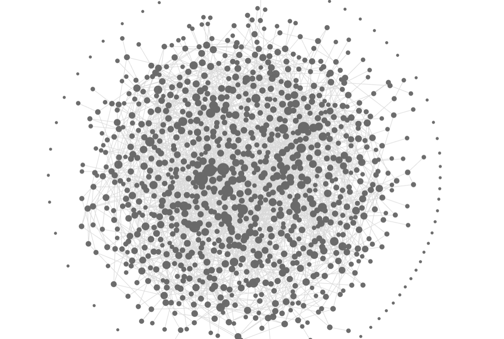
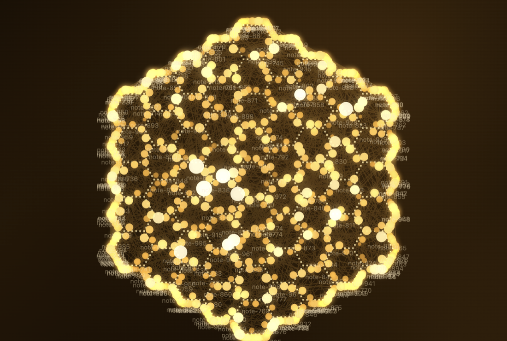

# Fast Graph

A graph view for Obsidian that stays smooth on very large vaults. It works out the layout in the background, so zooming, panning and dragging never freeze, even with tens of thousands of notes.


*The default look: a plain graph in your theme's colours (1,000 notes).*


*One of the optional shape layouts: Honeycomb.*

## How fast is it, compared with Obsidian's built-in graph?

Much smoother on big vaults. Here are the numbers for **25,300 notes and 59,867 links**:

| | Built-in graph | Fast Graph, first open | Fast Graph, reopened |
|---|---|---|---|
| First picture on screen | 0.77 s | 0.35 s | 0.06 s |
| App busy while opening | 14.4 s | 3.1 s | 0.06 s |
| Freezes over 50 ms while opening | 556 | 2 | 0 |
| Time per frame while zooming and panning | 124 ms (about 8 per second) | 8.3 ms | 8.3 ms |
| Memory added | +420 MB | +9 MB | about 0 |

**In plain words:** about 4 to 5 times less busy on the first open, about 15 times smoother while you move around, more than 40 times less memory, and a reopen in under a tenth of a second because the layout is saved. On 10,000 notes the same test gave 42 ms against 8.3 ms per frame. (8.3 ms is simply your screen's refresh rate: no dropped frames.)

**How far to trust this:** one MacBook, Obsidian 1.14.4, made-up vaults with random links, one run each, and the two graphs started with different zoom levels. The time to a fully calm picture is only about 1.5 times shorter on first open (10 s against 14.6 s); the big wins are smoothness, memory and the saved layout. Real vaults will differ. Method and every caveat: [docs/comparison.md](docs/comparison.md).

## What you get

**Always on**
- A fast, force-directed graph with a layout that is saved and restored.
- Filters (search, tags, orphans, attachments, **excluded folders**), colour groups, hover cards, drag notes to move them.
- A **local graph**: turn it on, then click a note to see it with its neighbours; click another to move on.
- Pan by dragging, or with the right or middle mouse button. Settings are behind the gear in the pane header.

**Off until you switch them on** (Settings → Fast Graph)
- **Shape layouts:** pull your notes into a heart, spiral galaxy, brain, trefoil knot, spider, spider web, **honeycomb**, an **arc reactor**, or a **solar system** (your most-connected notes become the sun and planets). Shapes bring their own colours; turn "Use the shape's own colours" off to keep your normal look.
- A **3D view**, moving **electrons** along links, a gentle **drift** so the graph feels alive, whole-graph **motion effects** (heartbeat, breathing, shockwave and more), **skins**, and zoomed-out **bubbles**.

**Make your own shapes.** A shape pack is one small file (data only, no code). Import it in the settings, copy any built-in one as a starting point. See [docs/pack-format.md](docs/pack-format.md).

## Install
- **Community plugins:** Settings → Community plugins → Browse → search "Fast Graph" (available once accepted into the directory).
- **By hand:** put `main.js`, `manifest.json` and `styles.css` from the [latest release](../../releases/latest) into `<your vault>/.obsidian/plugins/fast-graph/`, restart Obsidian, enable the plugin. Needs Obsidian 1.13.4 or newer.

Then open it from the ribbon icon, or run **Fast Graph: Open graph view**.

## Good to know
- **Not tested on phones or tablets.** It is not marked desktop-only, but I have never run it on iOS or Android. If it does not open on your device, please tell me.
- Tested on macOS only, on made-up vaults of up to 25,000 notes.
- Search looks at names, paths and tags, not the text inside notes.
- The brain shape is rough, and the web and honeycomb only read well with their dotted guide on (it is on by default for them).

## Privacy
No network, no accounts, no ads, no tracking. It reads note names, paths, links and tags, never the text of your notes, and writes only inside its own plugin folder (settings, the saved layout, and packs you import).

## For developers
The layout engine is Rust compiled to WebAssembly (`core/`); the plugin is TypeScript. The compiled files are committed, so you only need Node to build:

```sh
npm ci
npm run build   # makes main.js
npm run lint
npm test
```

To rebuild the engine you also need Rust and [wasm-pack](https://rustwasm.github.io/wasm-pack/): `npm run build:wasm`. The layout follows the d3-force model, written from its public description (no d3 code is included). Design notes and decisions: [docs/](docs/).

## Licence
[0BSD](LICENSE). The generated WebAssembly glue comes from [wasm-bindgen](https://github.com/rustwasm/wasm-bindgen) (MIT or Apache-2.0).
