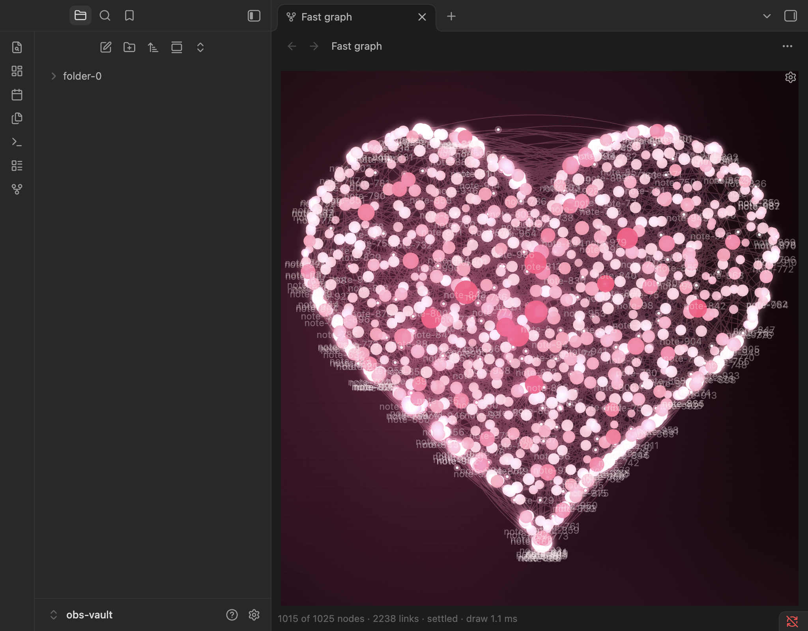

# Fast Graph

A graph view for Obsidian that stays smooth on very large vaults (10,000 notes and more). The layout is calculated off the main thread, in WebAssembly, so panning, zooming and dragging do not stall while it works. The default look is a plain graph in your theme's colours; everything else is an option you switch on.



## What you get

**By default** (nothing to set up)
- A force-directed graph of your notes, drawn on a canvas, with a layout that is saved and restored, so reopening a big vault is quick.
- Filters: search (names, paths, tags, `-not`, `OR`), attachments, orphans, existing files only, and **excluded folders**.
- Colour groups, a local graph (click a note to centre on it and its neighbours), hover cards, labels that fade in as you zoom, drag a note to move it.
- Mouse: drag empty space or use the right or middle button to pan, scroll to zoom. Touch: one finger pans, two fingers pinch. The settings gear is in the pane header, next to the "…" menu.

**Optional, all off until you turn them on (plugin settings)**
- Zoomed-out **bubbles** that show crowded areas with a note count.
- **Moving electrons** along the links, with a fading tail.
- **Gentle drift**: every note wanders a few pixels so the graph feels alive. It only changes how the graph is drawn; your real layout is never moved.
- **Motion effects** for the whole graph: heartbeat (with a lub-dub and an "active" mode), breathing, vibrate, a frightened flinch, panic, and a shockwave when you open or edit a note.
- A **3D view** (WebGL2): drag to turn, scroll to zoom, right-drag to slide.
- **Skins** drawn by code, not images: Galaxy and a stylised Brain.
- **Shape layouts**: pull the graph into a heart, a spiral galaxy, a brain, a trefoil knot, or a shape from a pack you import.
- Brightness, colour, glow, label and 3D camera controls.

Everything in the settings page has a short description. Extras never change the default graph.

## Packs: your own shapes, colours and layouts
A pack is one JSON file with themes, shapes and layouts. It contains **data only, never code**, and shapes use a small safe formula language (no `eval`). Import one from the settings page (paste it, or give its path in your vault), copy any pack as text to start your own, and remove packs you no longer want. The full format, the formula language, limits and four examples are in [docs/pack-format.md](docs/pack-format.md) and [docs/packs/](docs/packs/).

## Install
**From the community plugin list:** Settings → Community plugins → Browse → search for Fast Graph → Install → Enable. (Available once the plugin has been accepted into the directory.)

**By hand:** download `main.js`, `manifest.json` and `styles.css` from the latest [release](../../releases), put them in `<your vault>/.obsidian/plugins/fast-graph/`, restart Obsidian and enable the plugin. Needs Obsidian 1.13.4 or newer.

Open the graph from the ribbon icon or the command "Fast Graph: Open graph view".

## How it performs (measured, with caveats)
Measured on one MacBook with Obsidian 1.14.4, on synthetic vaults of random links, one run each, against Obsidian's built-in graph view. Full method and every caveat: [docs/comparison.md](docs/comparison.md).

| 25,300 notes, 59,867 links | Built-in graph | Fast Graph (first open) | Fast Graph (saved layout) |
|---|---|---|---|
| Main thread busy while opening | 14.4 s | 3.1 s | 0.06 s |
| Long tasks while opening (over 50 ms) | 556 | 2 | 0 |
| Frame interval while zooming and panning, median | 124 ms | 8.3 ms | 8.3 ms |
| JS memory added | +420 MB | +9 MB | about 0 |

Read this fairly: 8.3 ms is simply the display's refresh rate (no dropped frames), the two graphs started with different cameras, the vaults are synthetic, and I did not measure GPU time, battery or worker CPU. Cold settle time is only about 1.5 times faster than the built-in graph's (10.0 s against 14.6 s); the very fast opens come from the saved layout. The optional effects cost a little on top (for example, on a 10,000-note vault: electrons about +0.2 to 0.6 ms per frame flat and +0.5 to 1.1 ms in 3D, drift about +0.2 ms flat and +0.7 to 0.9 ms in 3D).

## What it does not do (yet)
- **Mobile is untested.** The plugin is not marked desktop-only, but I have not run it on iOS or Android. If the worker, WebAssembly or WebGL2 is unavailable on your device, the graph may not open; please report it.
- Search matches names, paths and tags, **not note contents**, and has fewer operators than Obsidian's own search. Tags are not drawn as nodes.
- The built-in graph's link and node options are not all copied.
- Shapes: the heart, the spiral galaxy and the trefoil read well; the **brain is rough** (a rounded blob with a stem; its lobes are not distinct). Shapes were tuned on a small synthetic vault only.
- Zoomed-out bubbles show density on a grid, not real communities.
- Not yet tested on real (non-synthetic) vaults beyond quick checks, or on older graphics hardware. 3D opens settle in about 20 s cold on 25,000 notes.

## Privacy and what it touches
- **No network use.** No accounts, no payments, no ads, no telemetry, no remote code.
- It reads note **names, paths, links and tags** from Obsidian's own index. It never reads or sends note text.
- It writes only inside its own plugin folder (`<vault>/.obsidian/plugins/fast-graph/`): your settings (`data.json`), the saved layout (`layout-cache.bin`, `layout-cache-3d.bin`) and any packs you import (`packs/`). Nothing is written elsewhere. "Clear saved layout" in the settings deletes the layout files.
- "Copy as text" puts a pack on your clipboard only when you choose it.
- Reduced-motion: all moving effects stop if your system asks for reduced motion.

## Build from source
The compiled WebAssembly (`src/generated/core.wasm`) and its generated glue (`core/pkg/`) are committed, so building the plugin needs only Node:

```sh
npm ci
npm run build      # type-check and bundle to main.js
npm run lint
npm test
```

The layout engine is Rust, in `core/`. To rebuild it you need Rust and [wasm-pack](https://rustwasm.github.io/wasm-pack/): `npm run build:wasm`, then `cd core && cargo test`. The build embeds the worker and the `.wasm` inside `main.js`, so the three release files are all anyone needs.

The layout follows the d3-force model (centre, many-body with Barnes-Hut, link force, velocity decay and alpha cooling), reimplemented from its public description; no d3 code is included. The design notes and decisions are in [docs/](docs/) (start with `docs/README.md`).

## Licence
[0BSD](LICENSE). Third-party: the generated WebAssembly glue comes from [wasm-bindgen](https://github.com/rustwasm/wasm-bindgen) (MIT or Apache-2.0).
